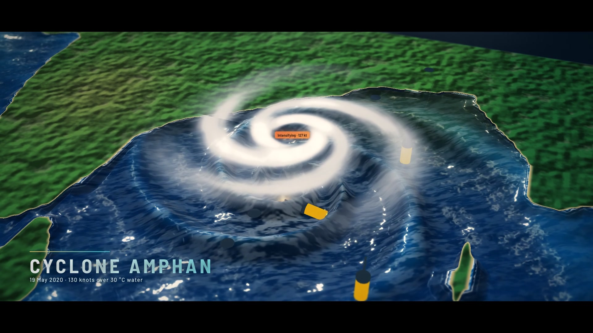

# OceanScope

An interactive 3D model of the North Indian Ocean that you can cut open like a cake. Dive into any point of the water, see where the ocean model disagrees with Argo floats, replay Cyclone Amphan, predict where a person lost at sea will drift, trace sonar quiet zones, and learn what lives at every depth. Everything runs in the browser on procedural, July-like stand-in data; there is no backend.



## Run it

```bash
python3 oceanscope/serve.py
```

Then open http://localhost:8765. You need a browser with WebGL 2 (recent Chrome, Edge, Firefox or Safari) and an internet connection on first load for three.js and the fonts.

## What's in the repo

| Folder or file | What it is |
| --- | --- |
| `oceanscope/` | The app: seven views (Ocean Slicer, Truth Meter, Cyclone Lab, Search & Rescue, Sonar, Learn, Copilot), cinema mode and film mode. See its [README](oceanscope/README.md). |
| `video/` | The toolkit that renders the product film from the live app, frame by frame, with narration and an original score. See its [README](video/README.md). |
| `oceanscope-claude-code-prd.md` | The product requirements the app was built from. |
| `ocean-cake.html` | The original single-page "ocean cake cutter" prototype. |

## Product film

The demo films are rendered with `video/` and are not stored in the repo, because each is larger than GitHub's 100 MB file limit. To render one yourself:

```bash
cd video
npm install
node record.js
```
